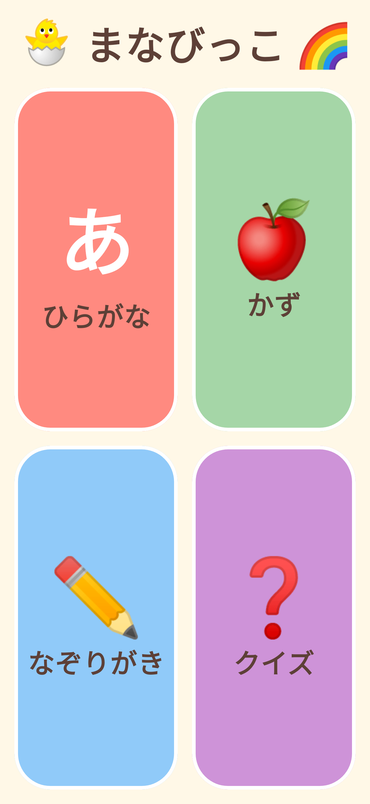
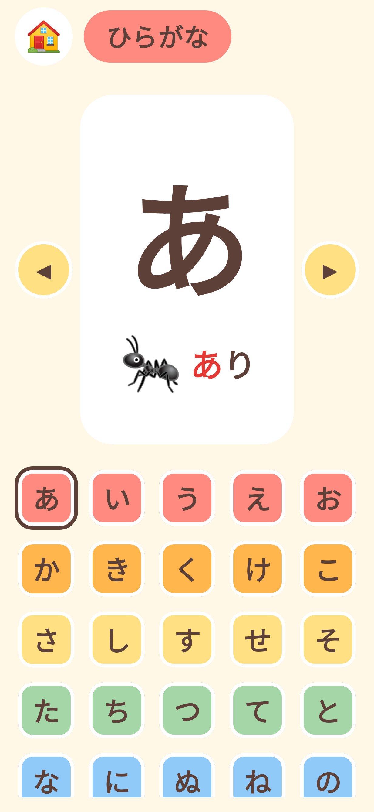
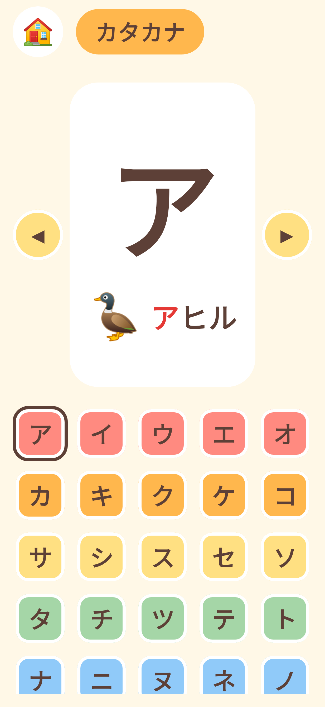
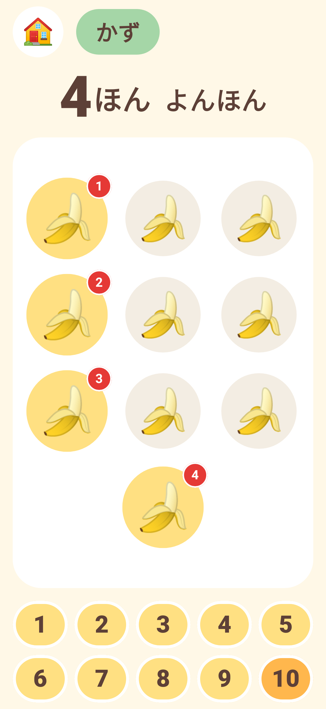
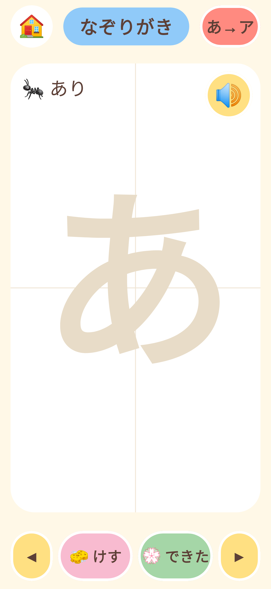
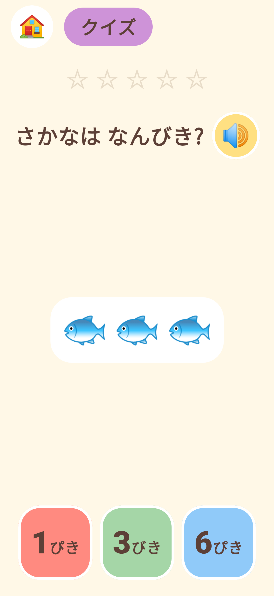

# まなびっこ 🐣

3さいごろの子ども向けの、**ひらがな**と**かず**をおぼえる Android アプリです。
文字がまだ読めなくても遊べるように、ボタンは大きく、すべて**音声で読み上げ**ます(端末の日本語読み上げエンジンを使います)。

| ホーム | ひらがな | カタカナ | かず | なぞりがき | クイズ |
|---|---|---|---|---|---|
|  |  |  |  |  |  |

## あそびかた

- **ひらがな** … 五十音表から文字をタップすると、大きく表示して「あ。あり」のように読み上げます。◀ ▶ でじゅんばんに見られます。46文字すべてに、絵文字つきのことばがあります。
- **カタカナ** … ひらがなと同じしくみで、「ア。アヒル🦆」のようにカタカナを学べます(ヲ以外の45文字)。
- **かず** … 1〜10 を選ぶと、その数だけりんごなどが出てきます。ひとつずつタップすると「いっぽん、にほん、さんぼん…」のように、**ものに合わせた数え方(〜こ・〜ほん・〜ひき・〜だい・〜わ)**で数え(ドレミ…と音も高くなります)、さいごに「ばななは さんぼん。よくできたね!」とほめてくれます。画面にも「3ぼん」のように単位つきで表示します。できたら自動でつぎの数へ進みます。
- **なぞりがき** … うすく書かれたひらがな/カタカナ(右上で切りかえ)を、ゆびでなぞります。線は1本ごとに色が変わります。「できた」をおすと**採点**します(下記)。
- **クイズ** … 「『あ』はどれかな?」「『ア』はどれかな?」「さかなはなんびき?」を3択で出題します(数は 3さい向けに 1〜5)。5問で1ラウンド、1回目で正解すると ⭐ がもらえます。まちがえても、ぷるぷるゆれて「もういっかい!」と言うだけなので、何度でもやり直せます。

## なぞりがきの採点

おてほんの文字と、かいた線をこまかいマス目(画面の短い辺を48マス)にして比べます。

- **はみだし率**:かいた線のうち、おてほんの近く(3マス以内)にある割合
- **なぞり率**:おてほんのうち、かいた線の近く(3マス以内)にある割合

| けっか | 条件 | 表示 |
|---|---|---|
| はなまる | はみだし率 85%以上 かつ なぞり率 75%以上 | 💮 ファンファーレ |
| じょうず | はみだし率 70%以上 かつ なぞり率 65%以上 | ⭕ |
| おしい | それ以外(大きくずれている・ぐちゃぐちゃ・半分しかなぞっていない など) | 🙂 「もういっかい」→ 線を消してやり直し |

3さい向けに判定はゆるめです。文字の大きさの 6% ほどずれても OK、30% ずれると NG になるよう調整しています。
しきい値は `trace/TraceScorer.kt` の定数で変えられます。
なお、形の似た別の文字(線の重なりが多いもの)を書いた場合に OK になることがあります(文字の判別まではしていません)。

## こどもが アプリから でてしまわないように

- アプリは**全画面**で動きます(ステータスバー・ナビゲーションバーをかくします)。
- ホーム画面では「もどる」を押してもアプリは閉じません。
- さらに、**おとなが タイトル「まなびっこ」を 3秒 長押し**すると、Android の「アプリ固定(画面の固定)」が
  オンになり、ホームボタンやアプリ切りかえでも外に出られなくなります(右上に 🔒 が出ます)。
  もう一度 3秒 長押しすると解除できます。
  - 事前に端末の **設定 → セキュリティ → アプリ固定**(機種により「画面の固定」)を **オン** にしてください。
  - 解除は、長押しのほかに「戻る」と「最近使ったアプリ」ボタンの同時長押しでもできます。

## 効果音

ボタンの「ぽん」、かぞえるときの「ドレミ…」、正解の「ピロリン」、まちがいの「ぼよよん」、
できたときのファンファーレ、けすときの「しゅっ」があります。
音素材は外部から持ってこず、`tools/make_sounds.py` でプログラム合成した wav(`app/src/main/res/raw/`)です。

## つくり

- Kotlin + Jetpack Compose(外部ライブラリなし、画像素材なし ― イラストは絵文字)
- 音声は Android 標準の `TextToSpeech`(日本語)。ゆっくり・すこし高めの声に設定しています。
- 縦向き・横向き、スマホ・タブレットに対応。全画面表示で、あそんでいる間は画面がスリープしません。
- 対応 OS: Android 8.0(API 26)以上

```
app/src/main/java/com/toyontaker/manabikko/
├── MainActivity.kt      画面の切りかえ
├── Speaker.kt           音声読み上げ
├── Sfx.kt               効果音
├── data/                ひらがな・カタカナ・数(じょすうし)のデータ
├── trace/               なぞりがきの採点
└── ui/                  各画面(Home / Kana / Counting / Tracing / Quiz)
```

## ビルドとインストール

Android Studio でこの `manabikko` フォルダを開いて ▶ 実行するのがかんたんです。
コマンドラインの場合(Android SDK が必要):

```bash
cd manabikko
./gradlew assembleDebug
adb install app/build/outputs/apk/debug/app-debug.apk
```

> 音声が出ないときは、端末の「設定 → システム → 言語と入力 → テキスト読み上げの出力」で
> Google 音声サービスなどの日本語音声データが入っているか確認してください。

### スクリーンショットの更新

画面のスクリーンショットは Robolectric + Roborazzi で JVM 上に描画しています(エミュレータ不要)。

```bash
./gradlew recordRoborazziDebug   # app/screenshots/*.png を更新
```
